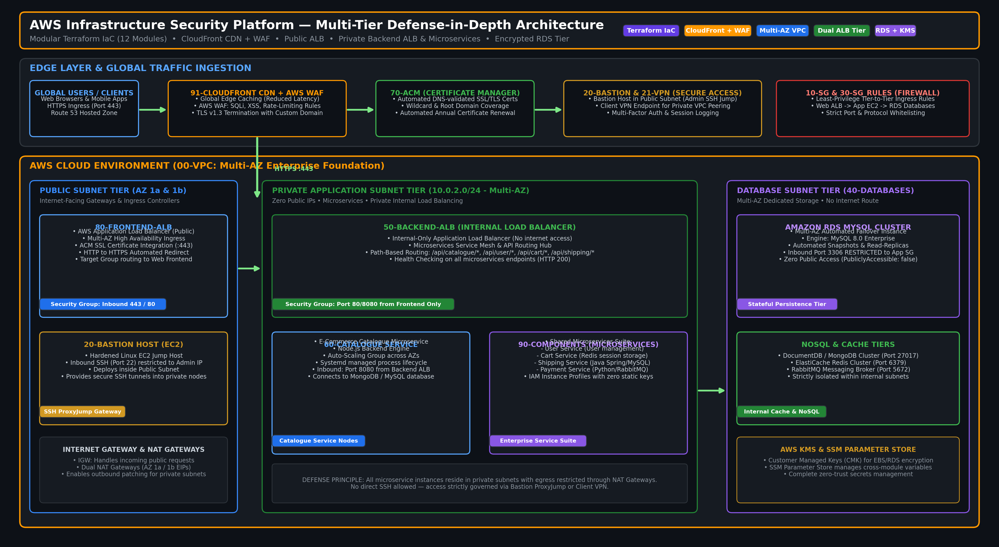

# 🛡️ AWS Infrastructure Security Platform

<div align="center">

[](https://www.terraform.io/)
[](https://aws.amazon.com/)
[](https://aws.amazon.com/cloudfront/)
[](https://aws.amazon.com/kms/)
[](LICENSE)

**Enterprise-Grade, Defense-in-Depth AWS Multi-Tier Cloud Architecture Built with 12 Modular Terraform Components**

---

</div>

## 📌 Executive Summary

This project provisions a production-ready, security-hardened AWS infrastructure platform following the **AWS Well-Architected Framework (Security & Reliability Pillars)**. Built with 12 independent, loosely coupled Terraform modules, it enforces complete defense-in-depth across the edge, ingress, compute, and database tiers.

**Key Architecture Highlights:**
- 🛡️ **Edge Protection**: Amazon CloudFront global content delivery network paired with AWS WAF rate-limiting and OWASP Top 10 mitigation rules.
- 🌐 **Dual ALB Architecture**: Clear separation of concerns between public internet-facing Application Load Balancers and internal, VPC-only backend Load Balancers.
- 🔐 **Zero Direct DB Access**: Databases (RDS MySQL & NoSQL) are isolated in private, non-routable subnets with encryption at rest using AWS KMS Customer Managed Keys.
- 🚪 **Secure Administrative Access**: Complete elimination of public SSH — access is strictly governed via a Bastion Jump Host and AWS Client VPN.

---

## 🏛 Architecture Diagram



---

## 🧰 Modular Terraform Architecture (12 Components)

Each directory represents an independent, state-isolated Terraform module deployed in sequence:

| Order | Module | Description & Security Controls |
| :--- | :--- | :--- |
| **`00-vpc`** | **Core Networking** | Multi-AZ VPC with Public, Private Application, and Private Database subnets across 2 AZs with IGW and NAT Gateways. |
| **`10-sg`** | **Security Groups** | Baseline security groups adhering to least-privilege principle (Default DENY all inbound). |
| **`20-bastion`** | **Bastion Jump Host** | Hardened EC2 instance in public subnet for controlled administrative SSH tunneling. |
| **`21-vpn`** | **Client VPN Endpoint** | Secure private VPN tunnel for developer & administrator access to private subnets. |
| **`30-sg_rules`** | **Inter-Tier Firewall Rules** | Granular security group ingress rules permitting traffic only between adjacent tiers (ALB $\rightarrow$ App $\rightarrow$ DB). |
| **`40-databases`** | **Data Persistence Tier** | Amazon RDS MySQL Multi-AZ cluster with AWS KMS encryption at rest and automated backups. |
| **`50-backend-alb`** | **Internal Load Balancer** | VPC-internal Application Load Balancer routing microservice traffic securely without public exposure. |
| **`60-catalogue`** | **Catalogue Microservice** | E-commerce catalogue service on Auto-Scaling EC2 instances with systemd process management. |
| **`70-acm`** | **Certificate Manager** | Automated TLS/SSL certificate issuance and renewal via DNS validation. |
| **`80-frontend-alb`** | **Public Ingress ALB** | Internet-facing Application Load Balancer handling HTTPS termination (:443) and redirecting HTTP (:80). |
| **`90-components`** | **Core Microservices** | Shared application backend components (User, Cart, Shipping, Payment) with IAM Instance Profiles. |
| **`91-cloudfront`** | **Edge CDN & WAF** | Global CloudFront distribution with Origin Access Identity (OAI) and AWS WAF protection. |

---

## 🚀 Lifecycle Operations (Deploy & Destroy)

### Automated Deployment (Dependency Order)
```bash
for i in 00-vpc 10-sg 30-sg_rules 20-bastion 21-vpn 40-databases 50-backend-alb 60-catalogue 70-acm 80-frontend-alb 90-components 91-cloudfront; do
  echo ">>> Deploying module: $i"
  (cd "$i" && terraform init && terraform apply -auto-approve)
done
```

### Automated Tear-Down (Reverse Dependency Order)
```bash
for i in 91-cloudfront 90-components 80-frontend-alb 70-acm 60-catalogue 50-backend-alb 40-databases 21-vpn 20-bastion 30-sg_rules 10-sg 00-vpc; do
  echo ">>> Destroying module: $i"
  (cd "$i" && terraform destroy -auto-approve)
done
```

---

## 🛡️ Enterprise Security Controls Implemented
- **Data Encryption**: All RDS storage, EBS root volumes, and S3 state buckets are encrypted at rest using AWS KMS (AES-256).
- **Zero Static Secrets**: EC2 instances utilize IAM Instance Profiles and Roles instead of static AWS access keys.
- **Network Segmentation**: Strict 3-tier subnet architecture ensures zero database connectivity from the public internet.
- **State File Isolation**: S3 backend with DynamoDB state-locking prevents concurrent deployment conflicts.
